# The Node.js Toolchain, Explained

This document explains **why** each tool in the Node.js toolchain exists and **how** the tools work together. It builds the toolchain up one tool at a time: each chapter starts from a problem, introduces the tool that solves it, and ends with the limitation that leads to the next chapter.

Each chapter has three parts:

1. **In the kitchen**: the idea, told as a cooking analogy.
2. **In the toolchain**: the real tools and how they work.
3. **How they match**: which real tool plays which role.

For exact file contents, commands, and settings, see [`docs/reference/project-files.md`](../reference/project-files.md).

---

## Chapter 1: Running code outside the browser (Node.js)

### In the kitchen

Recipes are written in a common recipe language. For a long time, only one kitchen could cook them: the restaurant's kitchen. Anyone who wanted the dish had to go to the restaurant.

Then home kitchens appeared. The same recipes can now be cooked anywhere there is a home kitchen.

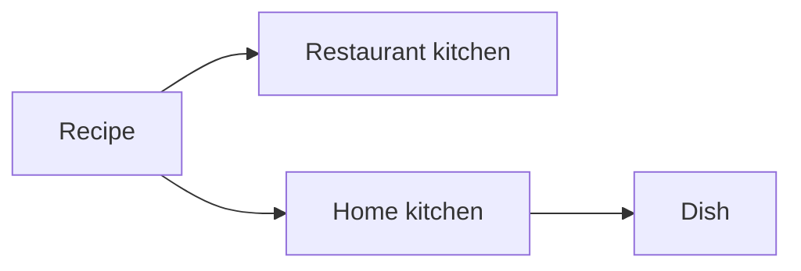

### In the toolchain

JavaScript was created to run inside web browsers. **Node.js** is a program that runs JavaScript outside a browser: on a laptop, on a CI runner, on a server, inside a container. That makes JavaScript usable for servers and command-line tools.

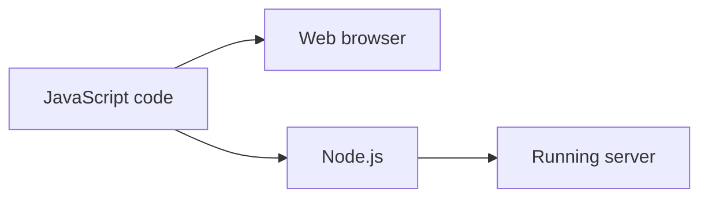

Running a file:

```bash
node server.js
```

### How they match

| Kitchen | Toolchain |
|---|---|
| Recipe language | JavaScript |
| Restaurant kitchen | Web browser |
| Home kitchen | Node.js |
| Cooking a recipe | Running a program |

### Limitation

**Kitchen:** every sauce, dough, and spice mix has to be made from scratch for every meal.
**Toolchain:** every piece of functionality has to be written from scratch for every project.

---

## Chapter 2: Reusing other people's work (npm)

### In the kitchen

Other cooks have already made sauces, doughs, and spice mixes, and they share them in a huge **supermarket**. Instead of going there in person, the cook writes a **shopping list**. A **delivery service** reads the list, fetches the items, and puts them in the **pantry**. The kitchen then cooks using what is in the pantry.

The shopping list has two sections: **ingredients** that end up in the dish, and **kitchen tools** that are only used while preparing it.

Ingredients often contain other ingredients. A sauce may contain a spice mix the cook never ordered. The delivery brings those too.

The pantry is never written down item by item. It can always be refilled from the shopping list.

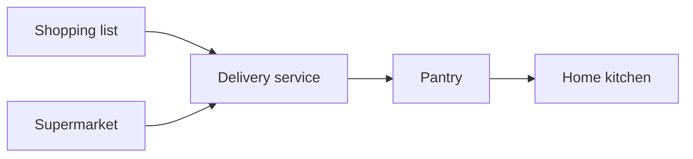

### In the toolchain

The **npm registry** (npmjs.com) is a public catalogue of millions of reusable code **packages**. Anyone can publish to it, which is why supply-chain security matters.

The **`npm` command** (installed together with Node.js) reads the project's **`package.json`**, downloads the listed packages, and stores them in the **`node_modules/`** folder. Node.js loads packages from there when the program runs.

`package.json` separates two kinds of packages:

- **`dependencies`**: needed when the application runs.
- **`devDependencies`**: needed only to build or develop it (compilers, linters, test runners).

Packages depend on other packages. The ones a project lists itself are **direct dependencies**. The ones those packages bring along are **transitive dependencies**, and a project usually has far more of them than direct ones.

`node_modules/` is not committed to Git. It is large and can be recreated from `package.json` at any time.

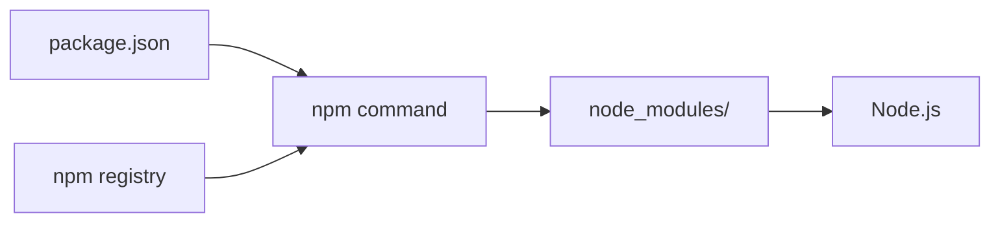

### How they match

| Kitchen | Toolchain |
|---|---|
| Supermarket | npm registry |
| Shared sauce or dough | Package |
| Shopping list | `package.json` |
| Ingredients section | `dependencies` |
| Kitchen tools section | `devDependencies` |
| Hidden ingredients inside a sauce | Transitive dependencies |
| Delivery service | `npm` command |
| Pantry | `node_modules/` |

### Limitation

**Kitchen:** the shopping list says "tomato sauce, roughly version 5". A delivery in May brings one sauce; a delivery in June brings a newer one with a different recipe. The hidden ingredients can change too. Same list, different dish. If a supplier is compromised, a "newer" sauce can contain something harmful.

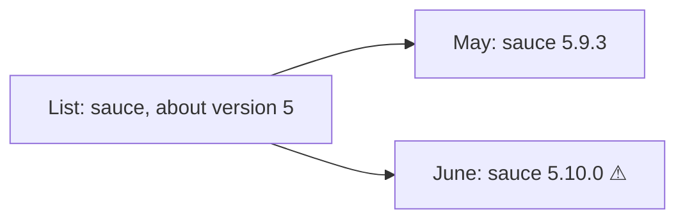

**Toolchain:** by default, npm writes **version ranges** into `package.json`, such as `"^5.9.3"`, which means "5.9.3 or any newer 5.x". Two installs at different times can produce different code, including different transitive dependencies. A compromised package can publish a new version that falls inside the range.

---

## Chapter 3: Getting exactly the same thing every time (lockfile, npm ci, .npmrc)

### In the kitchen

Three habits close the gap:

1. **Keep the receipt.** After every delivery, the delivery service prints an itemized receipt: every item, including the hidden ingredients, with its exact batch number and a tamper-evident seal.
2. **Reorder from the receipt.** When the pantry is restocked, the delivery service brings exactly what the receipt lists, and checks each seal. If the receipt and the shopping list disagree, the order is refused instead of improvised.
3. **Write "no substitutions" on the list.** The shopping list itself names exact batches. Even if the receipt is lost, the list still says precisely what was approved.

New batches are accepted only on purpose: someone proposes a change to the list, it gets checked, and only then is it adopted.

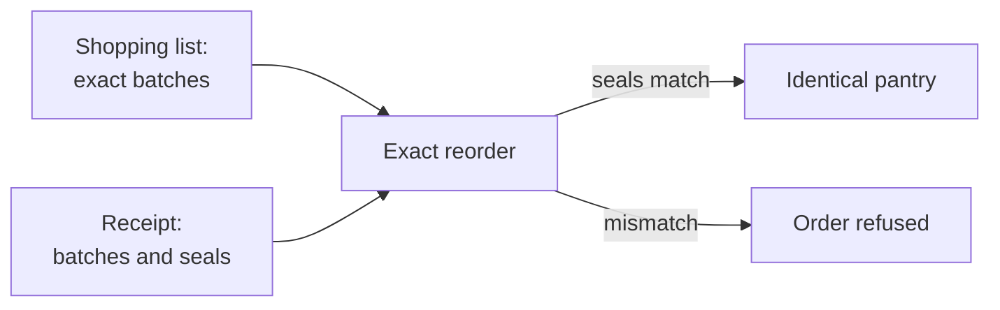

### In the toolchain

1. **`package-lock.json`**, the lockfile. npm writes it on every install. It records every package in the tree, direct and transitive, with its exact version and an **integrity hash**. It is committed to Git and never edited by hand.
2. **`npm ci`** installs exactly what the lockfile says, verifies every hash, and **fails** if `package.json` and the lockfile disagree. CI pipelines always use it. (`npm install`, by contrast, may update the lockfile.)
3. **`.npmrc` with `save-exact=true`** makes npm write exact versions (`"5.9.3"`) into `package.json` instead of ranges. `package.json` then states exactly what was approved, even if the lockfile is ever regenerated.

Updates arrive only through review: Dependabot opens a pull request proposing a new version, the change is reviewed, then merged.

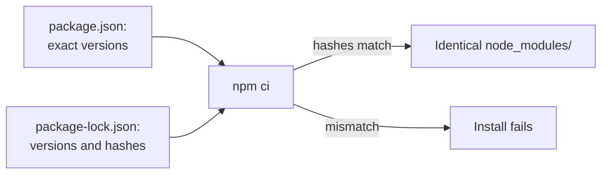

### How they match

| Kitchen | Toolchain |
|---|---|
| Receipt with batches and seals | `package-lock.json` (versions and integrity hashes) |
| Reorder exactly from the receipt | `npm ci` |
| "No substitutions" on the list | `.npmrc`: `save-exact=true` |
| Proposing and checking a new batch | Dependabot pull request and review |

### Limitation

**Kitchen:** the ingredients are identical, but the stoves are not. One kitchen has an older stove model, another a newer one. The same recipe can come out differently.
**Toolchain:** the packages are identical, but the **Node.js version** differs between machines (a laptop, a colleague's laptop, the CI runner). The same code can behave differently.

---

## Chapter 4: Using the same stove everywhere (nvm, .nvmrc)

### In the kitchen

A stove shop keeps several stove models side by side, and lets the cook switch between them instantly. Each recipe carries a **sticker** naming the exact stove model it was tested on. Before cooking, the cook reads the sticker and switches to that model.

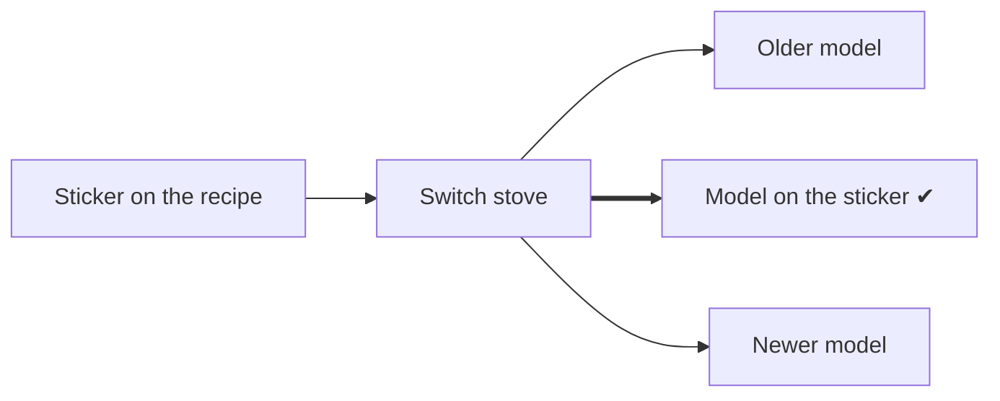

### In the toolchain

**nvm** (Node Version Manager) installs several Node.js versions side by side and switches between them. The project's **`.nvmrc`** file contains one line: the exact Node.js version.

- `nvm use` reads `.nvmrc` and switches to that version.
- `nvm install <version>` downloads a version from nodejs.org and verifies it against the published SHA-256 checksums.

Under the hood, nvm keeps versions in `~/.nvm/versions/node/` and changes the shell's `PATH`, so the `node` and `npm` commands point at the chosen version. Other tools (the CI pipeline, the container build) can read the same `.nvmrc`, so there is one source of truth for the version.

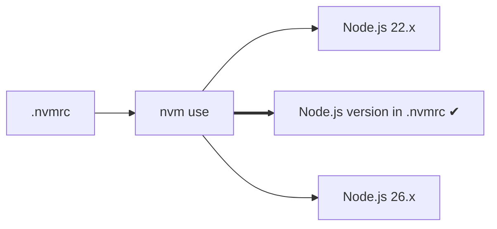

### How they match

| Kitchen | Toolchain |
|---|---|
| Stove shop | nvm |
| Stove model | Node.js version |
| Sticker on the recipe | `.nvmrc` |
| Switching stoves | `nvm use` |

### Limitation

**Kitchen:** recipes written in plain language are ambiguous. "Add 2 of salt": cups or pinches? The mistake is only noticed while cooking, or when someone tastes the dish.
**Toolchain:** JavaScript does not check whether values have the right kind. Passing text where a number is expected is only discovered at **runtime**, possibly in production.

---

## Chapter 5: Catching mistakes before cooking (TypeScript, tsc)

### In the kitchen

Recipes are now written with precise **annotations**: "2 *teaspoons* of salt". Before anything is cooked, a **proofreader** checks the annotated recipe for contradictions. If something doesn't add up, the recipe is sent back. If everything checks out, the proofreader writes a **plain copy** without annotations, and only the plain copy goes to the kitchen.

The proofreader follows a **style guide** (where to find recipes, where to put the copies, how strict to be) and consults the **kitchen's equipment manual**, which lists what each appliance can do, so a recipe can't ask the oven for something it can't do. The manual must match the stove model in use.

The proofreader is hired as part of the kitchen's own tools, so every kitchen uses the same proofreader.

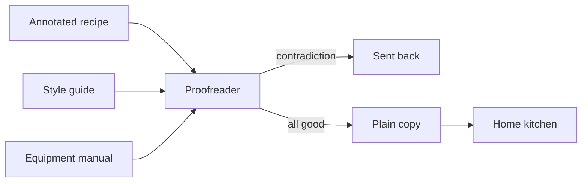

### In the toolchain

**TypeScript** is JavaScript plus **type annotations**. Node.js runs JavaScript, so TypeScript is first **compiled** by the TypeScript compiler, **`tsc`**. The compiler checks the types and stops with an error if they don't match. If they do, it writes plain JavaScript.

- **`tsconfig.json`** configures the compiler: source in `src/`, output to `dist/`, which JavaScript version to produce, how strict to be.
- **`@types/node`** is a package of **type definitions** describing Node.js's built-in modules (such as `node:http`). Its major version should match the Node.js major version.
- **`npx tsc`** runs the compiler from the project's `node_modules/`, so everyone uses the project's pinned compiler version rather than a global installation.
- `dist/` is not committed. It is regenerated from `src/`.

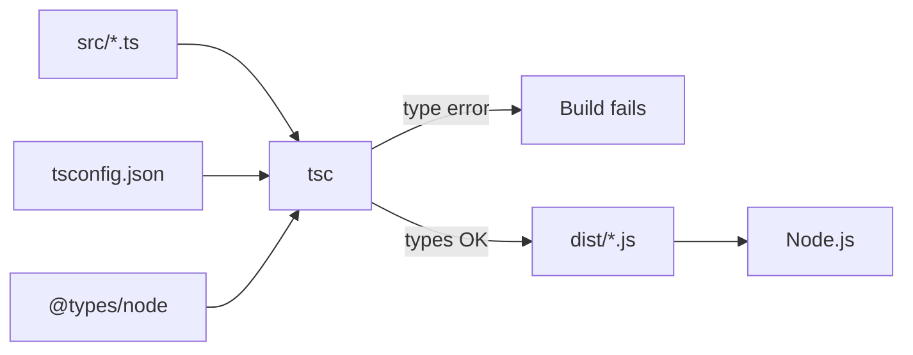

### How they match

| Kitchen | Toolchain |
|---|---|
| Annotated recipe | TypeScript source (`src/*.ts`) |
| Annotation ("teaspoons") | Type annotation |
| Proofreader | TypeScript compiler (`tsc`) |
| Style guide | `tsconfig.json` |
| Equipment manual | `@types/node` |
| Plain copy | Compiled JavaScript (`dist/*.js`) |
| Proofreader hired as one of the kitchen's own tools | `tsc` as a pinned devDependency, run with `npx` |

### Limitation

**Kitchen:** stove, ingredients, and proofreader are now all fixed, but only in this kitchen. Cooking somewhere else means rebuilding the whole kitchen first.
**Toolchain:** the Node.js version, packages, and compiler are all pinned, but running the project on another machine still requires installing nvm, Node.js, and everything else first. This is the problem **containers** (Docker) solve: packaging the application together with everything it needs to run.

---

## The whole picture

### In the kitchen

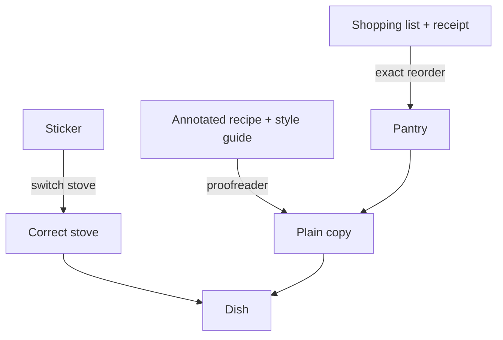

### In the toolchain

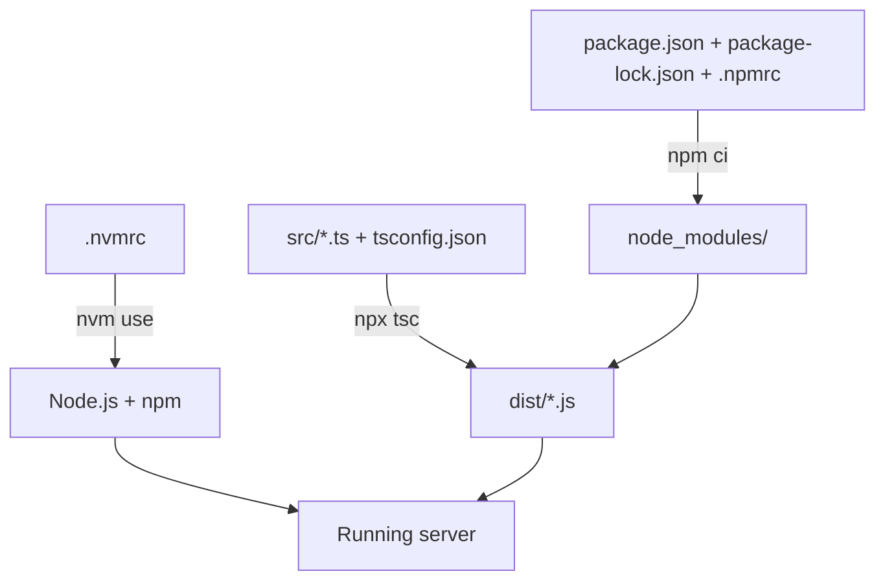
